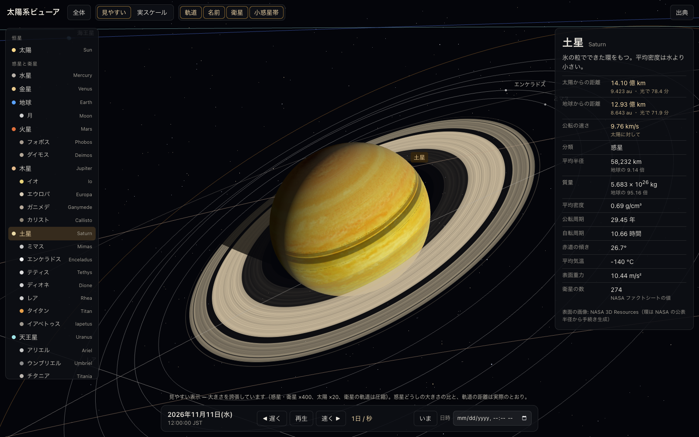

# 太陽系ビューア

JPL・NASA の公開データで動く、3D の太陽系ビューアです。日時を動かして惑星と衛星の位置を確かめ、
実スケール(距離も大きさも実際の比率)と見やすい表示を切り替えられます。ネット接続なしで動きます。



## 起動

| 方法 | 手順 |
| --- | --- |
| **Mac アプリ** | `npm install && npm run package` で `dist/太陽系ビューア.app` を作り、ダブルクリック(Apple Silicon 用。約 240 MB。リポジトリには含めていません) |
| Web 版 | `Web版を開く.command` をダブルクリック、または `node server.mjs` → http://localhost:5173 |
| スマホ・タブレット | `node server.mjs --host` で表示される `http://<Mac の IP>:5173` を同じ Wi-Fi の端末で開く |

- アプリは配布用の署名(Developer ID)を持たないアドホック署名です。この Mac で作ったものはそのまま開けます。
  別の Mac にコピーした場合は、初回だけ右クリック →「開く」が必要です。
- Web 版は PWA です。`localhost` で開くとブラウザの「インストール」からアプリとして登録でき、オフラインでも開けます。
  (`http://<IP>` 経由の端末ではブラウザ表示のみ。PWA の登録には HTTPS が必要です。)

## 操作

| やりたいこと | 操作 |
| --- | --- |
| 回す | ドラッグ / 1 本指でドラッグ |
| 拡大・縮小 | ホイール、トラックパッドのピンチ / 2 本指のピンチ、`+` `-` |
| 天体へ飛ぶ | 天体か名前をクリック(タップ)、左の一覧、数字キー `1`–`8`(水星–海王星) |
| 全体に戻る | 「全体」ボタン、`Esc` |
| 時間 | 「再生 / 一時停止」(`Space`)、「遅く」「速く」(`←` `→`、逆再生まで)、「いま」、日時の指定 |
| スケール | 「見やすい」⇔「実スケール」(約 2.5 秒かけて連続的に切り替わります) |
| 表示の切替 | 軌道 / 名前 / 衛星 / 小惑星帯 |

**見やすい表示**は大きさだけを誇張します(惑星・衛星 ×400、太陽 ×20、衛星の軌道は対数で圧縮)。
惑星どうしの大きさの比と、惑星の軌道の距離は実際のとおりです。**実スケール**では惑星は点にしか見えません。
天体を選ぶとそこまで飛ぶので、「地球から見た月の遠さ」や「太陽系のほとんどが空間であること」を体感できます。

## 何が実データで、何がそうでないか

| 項目 | 元データ | 扱い |
| --- | --- | --- |
| 惑星の位置 | JPL SSD「Approximate Positions of the Planets」のケプラー要素と変化率(1800–2050 年は表 1、それ以外は表 2) | ケプラー方程式を解く |
| 月の位置 | J. Meeus『Astronomical Algorithms』47 章の級数の主要項 | 地球–月重心から地球本体の位置も補正 |
| 他の衛星(20 個) | JPL「Planetary Satellite Mean Elements」(軌道の形・向き・歳差) | 位相(平均黄経)は JPL Horizons の位置に合わせて調整 |
| 準惑星(5 個) | JPL Small-Body Database の接触軌道要素 | 二体問題で伝播 |
| 大きさ・質量・周期 | JPL「Planetary Physical Parameters」「Planetary Satellite Physical Parameters」、NASA NSSDCA Planetary Fact Sheets | 表から機械的に抽出 |
| 自転(昼夜の位置) | NAIF 汎用 PCK `pck00011.tpc`(IAU の自転軸と本初子午線) | 衛星は公転と同期として計算 |
| 土星の環 | NASA NSSDCA「Saturnian Rings Fact Sheet」の半径 | 濃淡の模様は生成 |
| 星空 | Yale Bright Star Catalogue 第 5 版(9,096 星の位置・等級・色) | そのまま表示 |
| 小惑星帯 | — | **生成**。個々の点は実在の天体ではない(分布とカークウッドの空隙だけ似せた) |
| 太陽・天王星・ケレス・エリス・ハウメア・マケマケの模様 | — | **生成**(情報パネルにもその旨を表示) |

数値は手で書き写さず、`tools/build_data.py` が `raw/` に保存した公開ページから抜き出します(取得日 2026-11-11)。

## 検算(JPL Horizons との照合)

`node tools/verify-ephemeris.mjs` の結果(`raw/verify-report.json`)。

| 対象 | 照合した日付 | 誤差 |
| --- | --- | --- |
| 8 惑星の日心位置 | 1990-01-01 / 2026-11-11 / 2045-06-01 | 方向 最大 0.11°(内惑星は 0.01° 以下)、距離 最大 0.08% |
| 月(地心) | 2024-02-29 / 2029-07-04 / 2035-01-20 | 方向 最大 0.009°、距離 最大 21 km |
| 衛星 20 個(親天体から見た方向) | 同上(位相合わせに使っていない日付) | 17 個が 2.5° 以下。タイタン 3.0°、ミマス 3.7°、トリトン 7.5° |
| 冥王星 | 上の 3 日付 | 0.11° 以下 |
| ケレス | 上の 3 日付 | 2026 年 0.002°、1990 年 3.5°、2045 年 1.7° |
| 自転(太陽直下点の経度・緯度) | 2026-11-11 12:00 UT の地球・火星・木星 | 経度 0.1° 以下、緯度 0.11° 以下(光行時間を補正して比較) |

## 既知の制限

- 惑星の近似式の精度は 1800–2050 年で角度にして数分〜十数分。それより遠い時代(西暦 1000–3000 年まで指定可)は精度が落ちます。
- 衛星の位相は現在の前後 約 27 年に合わせてあります。それより離れた時代の衛星の位置は目安です。
- 準惑星は摂動を入れていないので、元期(2026 年前後)から離れるほどずれます(ケレスで数十年後に数度)。
- 自転の位相を Horizons と照合したのは地球・火星・木星のみ。他の惑星は同じ IAU モデルで計算していますが未照合です。
  地図の経度の原点が保証できるのは地球と月で、他の天体の画像は経度 0° を中央と仮定しています。
- フォボス・ダイモス・ハウメアなど、実際はいびつな天体も球で表示します。日食・月食の影は描きません(土星の環の影のみ)。
- うるう秒は 2017 年以降の値(TT − UTC = 69.184 秒)で固定です。
- `.app` は Apple Silicon 用のみ。動作確認は macOS 14 (Darwin 23.6) / Apple M2 Pro で行いました。

## 作り直す

```bash
npm install                 # three / electron / @electron/packager / puppeteer-core(開発用)
npm run data                # raw/ の表から数値を抽出し、衛星の位相を Horizons に合わせる(要ネット接続)
npm run verify              # JPL Horizons と照合(要ネット接続)
npm test                    # 操作 18 項目と PWA(オフライン)の自動確認
npm run package             # dist/太陽系ビューア.app を作る
```

## 構成

```
app/                 Web アプリ本体(これだけで動く。three.js は vendor/ に同梱)
  js/ephemeris.js    天体暦(位置と自転)          js/scene.js   3D シーン・カメラ・表示スケール
  js/bodies.js       天体の一覧と説明             js/app.js     画面と操作
  data/              生成した数値(軌道要素・物理量・衛星の位相・星表)
  textures/          天体の画像
electron/main.cjs    デスクトップアプリの入口
tools/               データ抽出・位相合わせ・検算・自動テスト・パッケージング
raw/                 取得した公開ページの写し、検算結果、確認用スクリーンショット
dist/                できあがった .app(git には含めていません)
```

## 出典とライセンス

| 素材 | 出典 | ライセンス |
| --- | --- | --- |
| 軌道要素・物理量・衛星要素・SBDB・Horizons | NASA/JPL Solar System Dynamics (ssd.jpl.nasa.gov) | 米国政府の著作物(パブリックドメイン) |
| ファクトシート | NASA NSSDCA Planetary Fact Sheets (nssdc.gsfc.nasa.gov) | 同上 |
| 自転モデル | NAIF `pck00011.tpc`(Archinal et al. 2018, IAU WGCCRE 2015) | 同上 |
| 金星・火星・木星・土星・海王星・冥王星と各衛星の画像 | NASA 3D Resources「Images and Textures」(github.com/nasa/NASA-3D-Resources) | 「free and without copyright」(NASA メディア利用ガイドライン) |
| 地球(昼) | NASA GSFC Scientific Visualization Studio「Blue Marble」(SVS 2915) | NASA、パブリックドメイン |
| 地球(夜景) | NASA Earth Observatory「Earth at Night」(Wikimedia Commons 経由) | パブリックドメイン |
| 月 | NASA SVS「CGI Moon Kit」(LRO) | NASA、パブリックドメイン |
| 水星 | MESSENGER MDIS 全球モザイク(NASA / JHUAPL / Carnegie、USGS。Wikimedia Commons 経由) | パブリックドメイン |
| 星表 | Yale Bright Star Catalogue 5th ed.(Hoffleit & Warren 1991、tdc-www.harvard.edu) | 自由に利用可 |
| 月の級数 | J. Meeus, *Astronomical Algorithms* 2nd ed., ch. 47(係数) | 計算式 |
| three.js r170 | threejs.org | MIT(`app/vendor/three.LICENSE.txt`) |
| Electron 33(Chromium を含む) | electronjs.org | MIT ほか(`dist/licenses/`) |

NASA の素材の利用は、NASA による本アプリの推奨・承認を意味しません。
